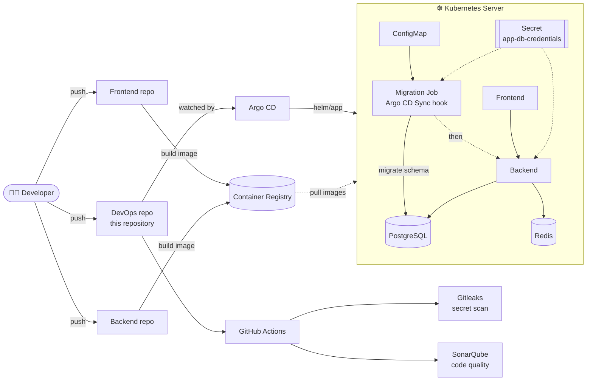
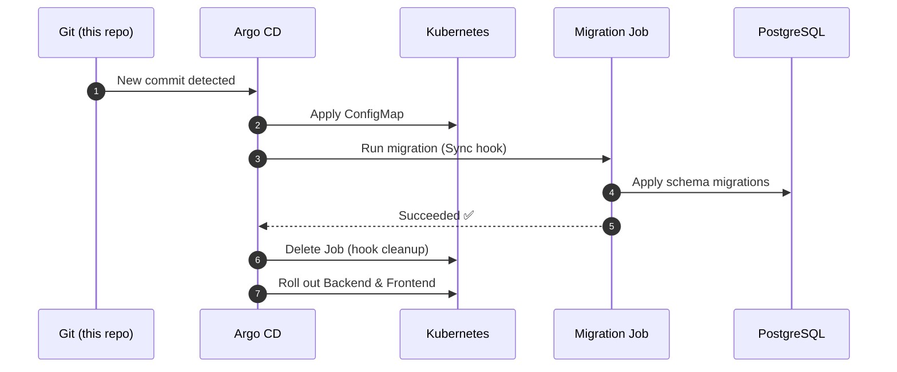

<div align="center">

# 🚀 Doratou DevOps

**GitOps-driven delivery infrastructure for the Doratou frontend & backend applications**

Helm · Argo CD · Ansible · GitHub Actions · Gitleaks · SonarQube

[](https://kubernetes.io/)
[](https://helm.sh/)
[](https://argo-cd.readthedocs.io/)
[](https://www.ansible.com/)
[](https://github.com/features/actions)
[](https://www.postgresql.org/)
[](https://redis.io/)
[](https://github.com/gitleaks/gitleaks)
[](https://www.sonarsource.com/)
[](LICENSE)

</div>

---

## 📑 Table of Contents

- [🚀 Doratou DevOps](#-doratou-devops)
  - [📑 Table of Contents](#-table-of-contents)
  - [🔭 Overview](#-overview)
    - [✨ Key Highlights](#-key-highlights)
  - [🏗️ Architecture](#️-architecture)
    - [End-to-end delivery flow](#end-to-end-delivery-flow)
    - [Argo CD sync order](#argo-cd-sync-order)
  - [📂 Repository Structure](#-repository-structure)
  - [🧰 Technology Stack](#-technology-stack)
  - [⎈ Helm Chart (`helm/app`)](#-helm-chart-helmapp)
  - [🗄️ Database Migration Job](#️-database-migration-job)
  - [🔐 Secrets Management](#-secrets-management)
  - [🔄 GitOps with Argo CD](#-gitops-with-argo-cd)
  - [🤖 Ansible Automation](#-ansible-automation)
  - [✅ CI \& Security Gates](#-ci--security-gates)
  - [🚦 Getting Started](#-getting-started)
    - [Prerequisites](#prerequisites)
    - [1. Clone the repository](#1-clone-the-repository)
    - [2. Create the database credentials Secret](#2-create-the-database-credentials-secret)
    - [3. Deploy](#3-deploy)
  - [🧾 Useful Commands](#-useful-commands)
  - [🗺️ Project Status \& Roadmap](#️-project-status--roadmap)
  - [📄 License](#-license)

---

## 🔭 Overview

This repository is the **single source of truth for deploying and operating the Doratou application stack**.
It connects the separate **frontend** and **backend** repositories to the server by packaging them as a Helm chart and delivering them through **Argo CD** (GitOps).

Everything that runs on the server is described declaratively in this repository:

| What | Where |
| ---- | ----- |
| Application packaging (frontend, backend, migration job) | `helm/app` |
| Continuous delivery definitions (Argo CD) | `gitops/` |
| Server / environment provisioning | `ansible/` |
| CI pipelines | `.github/` |
| Secret-leak scanning rules | `.gitleaks.toml` |
| Code quality analysis config | `sonar-project.properties` |

### ✨ Key Highlights

- 📦 **Helm packaging** – one chart deploys the frontend, the backend and the PostgreSQL migration Job.
- 🔄 **GitOps delivery** – Argo CD continuously reconciles the cluster with what is in Git.
- 🗄️ **Safe schema migrations** – migrations run as an Argo CD *Sync hook* before the backend starts.
- 🔐 **No secrets in Git** – credentials live in a Kubernetes Secret that is referenced, never rendered by the chart.
- 🛡️ **Automated quality & security gates** – Gitleaks secret scanning and SonarQube analysis.
- 🤖 **Ansible automation** – repeatable server preparation.

---

## 🏗️ Architecture

### End-to-end delivery flow



### Argo CD sync order

The migration Job is guaranteed to run **after the ConfigMap exists** and **before the backend Deployment** is updated.



---

## 📂 Repository Structure

```text
.
├── .github/                    # GitHub Actions workflows (CI / quality gates)
├── ansible/                    # Ansible automation for server provisioning
├── gitops/                     # Argo CD / GitOps definitions
├── helm/
│   └── app/                    # Main Helm chart
│                               #   ├─ frontend
│                               #   ├─ backend
│                               #   └─ PostgreSQL migration Job
├── .gitignore
├── .gitleaks.toml              # Gitleaks (secret scanning) configuration
├── LICENSE                     # MIT
├── README.md
└── sonar-project.properties    # SonarQube project configuration
```

> 💡 **Tip:** keep this tree in sync with the repository. If you add new folders (e.g. `docs/`, `scripts/`), add them here too.

---

## 🧰 Technology Stack

| Category | Tools | Purpose |
| -------- | ----- | ------- |
| **Orchestration & Packaging** | Kubernetes, Helm | Run and package the applications |
| **GitOps / CD** | Argo CD | Continuous delivery and drift correction |
| **CI** | GitHub Actions | Automated pipelines |
| **Automation / IaC** | Ansible | Server and environment provisioning |
| **Security** | Gitleaks | Detect leaked secrets in code and history |
| **Code Quality** | SonarQube | Static analysis and quality gate |
| **Data** | PostgreSQL, Redis | Persistent storage and caching |
| **Workloads** | Frontend app, Backend API | The Doratou application |

---

## ⎈ Helm Chart (`helm/app`)

A single chart deploys the whole application:

| Component | Kind | Description |
| --------- | ---- | ----------- |
| **Frontend** | Deployment | User-facing web application |
| **Backend** | Deployment | API service, configured through a ConfigMap and a Secret |
| **Migration Job** | Job (Argo CD hook) | Applies the PostgreSQL schema before the backend rolls out |
| **ConfigMap** | ConfigMap | Non-sensitive backend configuration (e.g. `PDB_USER`) |

Render and inspect the chart locally:

```bash
helm lint ./helm/app
helm template app ./helm/app
```

---

## 🗄️ Database Migration Job

The migration is intentionally **decoupled from the application runtime**, so schema changes never depend on a backend pod starting up.

| Property | Behaviour |
| -------- | --------- |
| Trigger | Argo CD **Sync hook** |
| Ordering | Runs **after** the chart ConfigMap and **before** the backend Deployment |
| Frequency | Runs on **every sync** |
| Cleanup | **Deleted automatically** after a successful run |
| DB user | `PDB_USER`, read from the **backend ConfigMap** |
| DB password | Read from the `app-db-credentials` Secret |
| Independence | Does **not** depend on `doratou-secrets` |

---

## 🔐 Secrets Management

Secrets are **never stored in this repository** – the chart only references an existing Kubernetes Secret.

| Secret key (in `app-db-credentials`) | Injected as env var | Used for |
| ------------------------------------ | ------------------- | -------- |
| `postgresql-password` | `PDB_PASSWORD` | PostgreSQL password |
| `redis-password` | `RDB_PASSWORD` | Redis password |

- The Secret name and the source keys can be **overridden in `values.yaml`** via `backend.databaseCredentials.existingSecret` (default: `app-db-credentials`).
- The raw example Secret manifest contains **placeholder values only** and is **intentionally not rendered** by the chart.
- `.gitleaks.toml` is used to scan for accidentally committed credentials.

Create the Secret on the cluster before the first sync:

```bash
kubectl create secret generic app-db-credentials \
  --namespace <your-namespace> \
  --from-literal=postgresql-password='<postgres-password>' \
  --from-literal=redis-password='<redis-password>'
```

---

## 🔄 GitOps with Argo CD

Argo CD watches this repository and keeps the cluster in sync with `helm/app`.

- **Git is the source of truth** – the cluster state is always reconciled to what is committed.
- **Ordered rollout** – ConfigMap → Migration Job (hook) → Backend → Frontend.
- **Self-cleaning hooks** – successful migration Jobs are removed automatically.
- Application definitions live in the [`gitops/`](gitops) directory.

The Argo CD Application manifest is [`gitops/doratou.yaml`](gitops/doratou.yaml).

| Setting | Value |
| ------- | ----- |
| Application name | `doratou` |
| Argo CD namespace | `argocd` |
| Target namespace | `doratou` (created automatically) |
| Source | `https://github.com/Doratou/Devops.git`, branch `main`, path `helm/app` |
| Destination server | `https://kubernetes.default.svc` (in-cluster Kubernetes API) |
| Sync policy | Automated; pruning and self-healing enabled |
| Sync option | `CreateNamespace=true` |

The Argo CD server is installed in the `argocd` namespace by the `helm_bootstrap` role. It is configured with `--insecure` and can be reached locally with `kubectl port-forward svc/argocd-server -n argocd 8080:80` (open `http://localhost:8080`).

---

## 🤖 Ansible Automation

The [`ansible/`](ansible) directory contains playbooks and roles used to prepare the server so the cluster and Argo CD can run on it in a repeatable way.

The main playbook is [`ansible/site.yml`](ansible/site.yml). It targets `all` hosts, gathers facts, and runs with privilege escalation. Its roles run in this order:

| Role | Responsibility |
| ---- | -------------- |
| `common` | Updates the apt cache, installs base and Kubernetes support packages, disables swap, and configures kernel modules and network parameters. |
| `xray` | Optionally installs and configures Xray from a local `config.json`, then configures the proxy; skipped when no local config is present. |
| `k3s` | Installs and starts the K3s server, configures kubeconfig and proxy settings, and waits for the Kubernetes API. |
| `helm_cli` | Installs the Helm CLI when it is not already present. |
| `headlamp` | Installs Headlamp in the cluster using Helm. |
| `sealed_secret` | Installs the Sealed Secrets controller and waits for it to become available. |
| `helm_bootstrap` | Installs Argo CD, waits for its resources, and applies the Doratou Application manifest. |

Role tags are defined in `site.yml` (for example, `common`, `k3s`, `secret`, and `gitops`) and can be used to select parts of the playbook. The repository includes development and CI inventories under `ansible/inventories/`.

```bash
cd ansible
ansible-playbook -i <inventory> <playbook>.yml
```

---

## ✅ CI & Security Gates

Pipelines are defined in [`.github/`](.github) and run on GitHub Actions.

| Gate | Tool | What it protects against |
| ---- | ---- | ------------------------ |
| 🔑 Secret scanning | **Gitleaks** (`.gitleaks.toml`) | Leaked passwords, tokens and API keys |
| 🧪 Code quality | **SonarQube** (`sonar-project.properties`) | Bugs, code smells and vulnerabilities |

The repository contains these GitHub Actions workflows:

| Workflow | Scope and checks |
| -------- | ---------------- |
| [`CI-Chart.yml`](.github/workflows/CI-Chart.yml) | Gitleaks secret scanning; Helm dependency build and lint; strict kubeconform validation of rendered manifests; Trivy IaC configuration scan; and a KinD chart installation test. |
| [`CI-Ansible.yml`](.github/workflows/CI-Ansible.yml) | Ansible playbook syntax check and ansible-lint, followed by a K3s and bootstrap integration test. |
| [`CI-SonarQube.yml`](.github/workflows/CI-SonarQube.yml) | SonarQube scan on pull requests. |

---

## 🚦 Getting Started

### Prerequisites

- A Kubernetes cluster with **Argo CD** installed
- `kubectl` and `helm` installed locally
- Access to the frontend and backend container images

### 1. Clone the repository

```bash
git clone https://github.com/Doratou/Devops.git
cd Devops
```

### 2. Create the database credentials Secret

See [Secrets Management](#-secrets-management).

### 3. Deploy

**Option A – through Argo CD (recommended):** register this repository and the `gitops/` application in Argo CD; every push to `main` will be synced automatically.

**Option B – directly with Helm:**

```bash
helm upgrade --install app ./helm/app \
  --namespace <your-namespace> --create-namespace
```

---

## 🧾 Useful Commands

```bash
# Check everything running in the namespace
kubectl get pods -n <your-namespace>

# Follow backend logs
kubectl logs -n <your-namespace> deploy/<backend-deployment> -f

# Check the migration Job (exists only during a sync)
kubectl get jobs -n <your-namespace>

# List Helm releases
helm list -A

# Render the chart without installing
helm template app ./helm/app
```

---

## 🗺️ Project Status & Roadmap

- [x] Helm chart for frontend, backend and PostgreSQL migration Job
- [x] Argo CD (GitOps) delivery
- [x] Migration Job as an ordered Argo CD Sync hook with automatic cleanup
- [x] Database credentials via an existing Kubernetes Secret (no secrets in Git)
- [x] Ansible automation
- [x] Gitleaks secret scanning
- [x] SonarQube code-quality analysis
- [ ] Monitoring & logging stack (Prometheus / Grafana / Loki)
- [ ] Secret management with External Secrets Operator or Vault
- [ ] Horizontal Pod Autoscaler (HPA)
- [ ] Multi-environment setup (staging / production)

---

## 📄 License

Distributed under the **MIT License**. See [`LICENSE`](LICENSE) for details.

---

<div align="center">

**Maintained by [@Doratou](https://github.com/Doratou)**

</div>
